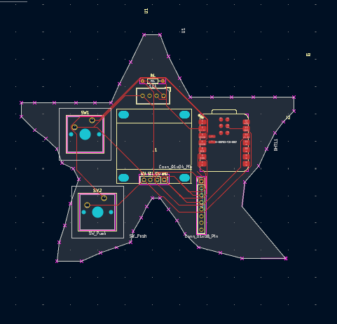
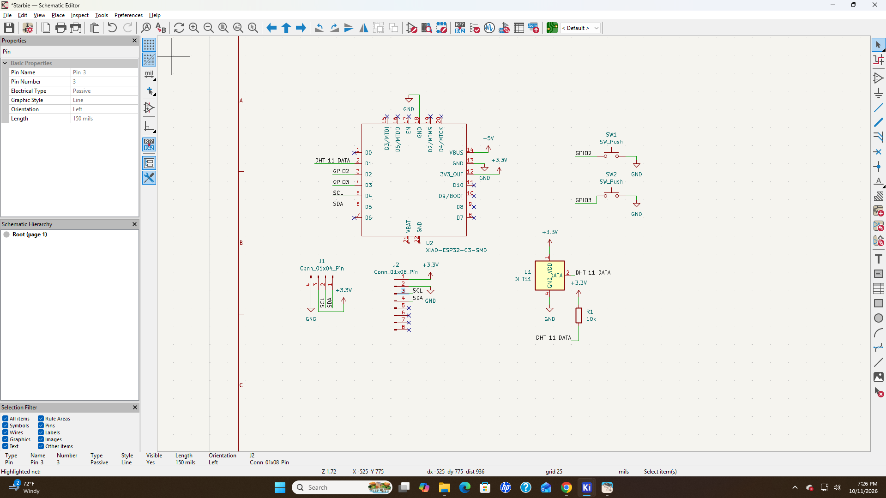
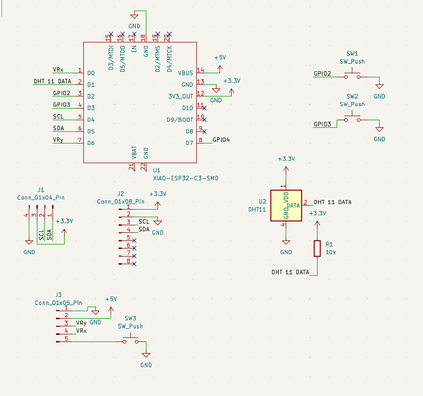

# Starbie
Starbie Project

I tried to do the starting starbie project but I did not know that I would run into so many problem. I first was struggling on downloading the software. Then strugling on importing the things in the care package.
Then I tried to make the schematic and succeeded. But, took another long amount of time just trying to work the assigning footprints thing. After I finally figured that out.
Another problem came. I was so confused on the PCB editor and after I figured out how to insert my components, lay them out, draw the edges and route the PCB I forgot to save and lost all of the PCB editor progress that I had.
